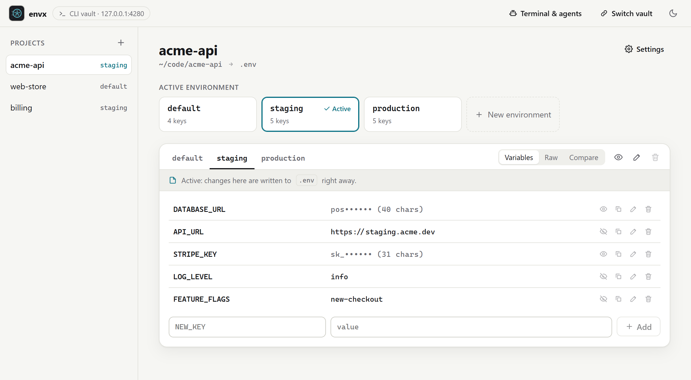

<p align="center"></p>

<h1 align="center">envx</h1>

<p align="center"><strong>Every <code>.env</code>, one click away.</strong></p>

<p align="center">
  <a href="https://github.com/ItsDEFAULT/env-x/actions/workflows/ci.yml"></a>
</p>

<p align="center"><a href="https://itsdefault.github.io/env-x/"><strong>Try it in your browser</strong></a> · no install, works in Chrome and Edge</p>

Stop commenting and uncommenting variables to change environments. envx imports the `.env` files from all your projects and switches between development, staging and production with one click, one command, or one tool call from your AI agent. Everything stays on your machine.



## Quick start

```sh
git clone https://github.com/ItsDEFAULT/env-x.git
cd env-x && npm install && npm run build
npm link -w @env-x/cli     # puts `envx` on your PATH

cd ~/code/my-app
envx import                # .env, .env.staging, .env.production → environments
envx use staging           # switch
envx ui                    # open the GUI
```

Requires Node.js 20 or later.

## Docs

- [Getting started](docs/getting-started.md): install, import, switch
- [CLI reference](docs/cli.md): every command and flag
- [Web app](docs/web-app.md): the GUI, installing it as an app, hosting it
- [AI agents](docs/ai-agents.md): let Claude Code, Cursor and others switch environments
- [How it works](docs/how-it-works.md): switching, hand edits, storage, security
- [Troubleshooting](docs/troubleshooting.md)
- [Architecture](docs/architecture.md): how the system is built, for contributors

## Contributing

See [CONTRIBUTING.md](CONTRIBUTING.md).

## License

[MIT](LICENSE)
