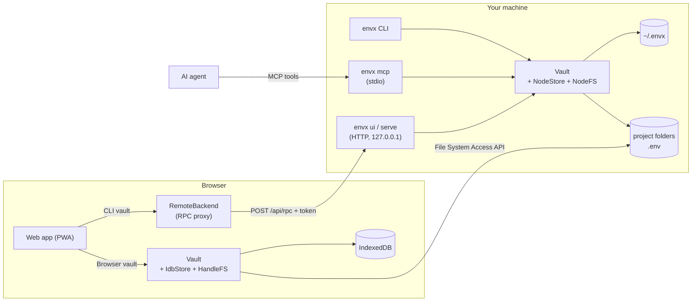
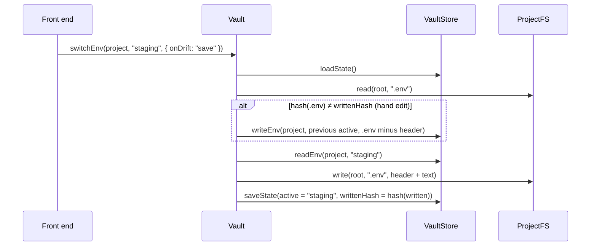
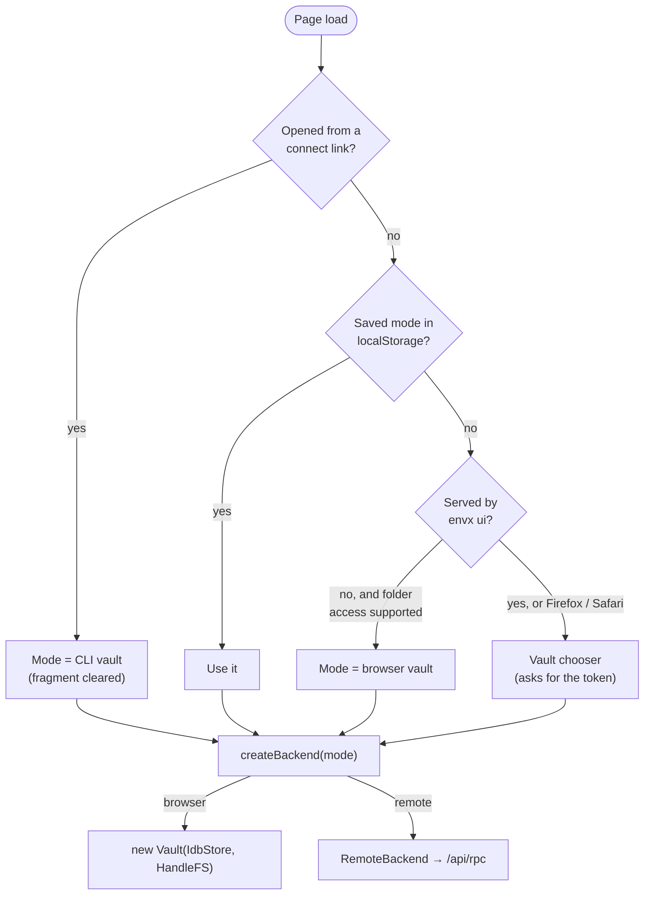

# Architecture

envx is one piece of logic, the **vault**, reached through four front ends: the CLI, the web app, the local server and the MCP server. Every front end runs the same `Vault` class from `@envx/core`. Only storage and file access change between environments.



## Packages

| Package | Runs in | Responsibility | Runtime deps |
| --- | --- | --- | --- |
| [`packages/core`](../packages/core/src) | anywhere | Dotenv parser, `Vault`, data model, errors | none |
| [`packages/cli`](../packages/cli/src) | Node ≥ 20 | Node adapters, CLI, local server, MCP server | `@envx/core` |
| [`packages/web`](../packages/web/src) | browser | React UI, browser adapters, remote backend, PWA | `@envx/core`, React |

The CLI bundles the built web app (`packages/cli/web`), so `envx ui` works offline with nothing else installed.

## Core

### Data model

```ts
interface Project {
  id: string;            // random, stable
  name: string;          // unique, case-insensitive
  root: string;          // folder path (Node) or handle key (browser)
  target: string;        // file holding the active env, e.g. ".env"
  envs: string[];        // environment names, in display order
  active: string | null; // env currently written to target
  writtenHash: string | null; // hash of what envx last wrote to target
  secure?: string[];          // envs that need confirmation before switching to them
  createdAt: string;
  updatedAt: string;
}
```

Projects live in a single `VaultState` (`{ version: 1, projects }`). Each environment's content is stored separately, as **raw text**.

### Ports and adapters

`Vault` depends on two interfaces and nothing else:

```ts
interface VaultStore {   // where the vault keeps its own data
  loadState(); saveState(state);
  readEnv(projectId, env); writeEnv(projectId, env, text);
  deleteEnv(projectId, env); deleteProject(projectId);
}
interface ProjectFS {    // access to the user's project folders
  list(root); read(root, file); write(root, file, text);
}
```

| Adapter | `VaultStore` | `ProjectFS` |
| --- | --- | --- |
| Node (CLI, server, MCP) | `NodeStore`: files in `~/.envx` | `NodeFS`: `node:fs` |
| Browser vault | `IdbStore`: IndexedDB | `HandleFS`: `FileSystemDirectoryHandle` |
| Tests | `MemoryStore` | `MemoryFS` |

To add a platform (Electron, a VS Code extension, …), implement these two interfaces.

### Dotenv parser

`parse.ts` never rebuilds a file from key/value pairs. It records the line range of each assignment, and edits (`setVar`, `unsetVar`) splice only those lines. As a result, comments, blank lines, ordering and CRLF endings survive every round trip. Parsing follows the `dotenv` package: last duplicate wins, double quotes expand only `\n` and `\r`, an unquoted value ends at a whitespace-preceded `#`. `formatValue` picks the quoting style that `dotenv` reads back unchanged.

### Switching and hand-edit detection



- envx writes `# envx: <env> (…)` as the first line of the target, and stores a hash (cyrb53, non-cryptographic) of exactly what it wrote.
- Any later difference between the file and that hash is a **hand edit** (`drift`). Policies: `save` (default: move the edits into the previously active env), `discard`, `error`.
- Saving the *active* env rewrites the target too, but refuses (`DRIFT`) when the target has hand edits, unless `force` is passed. `pull` resolves drift explicitly.
- On import, the current target becomes the baseline hash, so the first switch is not mistaken for drift.
- Before any of that, switching to an env listed in `project.secure` (other than the active one) throws `CONFIRM` unless the caller passes `confirm: true`. Each front end gets that from a human: a dialog, a `y/N` prompt or `--yes`, or MCP elicitation.

### Concurrency

The CLI, the local server and the MCP server can run at the same time against one vault. `Vault` holds no in-memory state: every call reloads `state.json`, applies its change and saves it. `NodeStore` writes through a temp file and `rename`, so readers never see a partial file. Two writes racing on the same project resolve as last-writer-wins. That's acceptable for a single-user tool, and the reason there's no long-lived cache.

### Errors

Domain errors are `EnvxError` with a `code`: `NOT_FOUND`, `EXISTS`, `INVALID`, `DRIFT`, `NO_PROJECT`, `PERMISSION`, `CONFIRM`. Each front end maps them to its own medium: exit codes, JSON-RPC results, MCP `isError`, UI toasts and dialogs.

## CLI

[`index.ts`](../packages/cli/src/index.ts) has a small built-in argument parser and one `switch` over commands. Each command resolves a project (`-p`, or the deepest imported root containing the current directory), calls one or two `Vault` methods, and prints either human output or `--json`. Exit codes: `0` success, `1` error, `2` `NO_PROJECT`.

## Local server

[`server.ts`](../packages/cli/src/server.ts) is a plain `node:http` server started by `envx ui` (API + web app, opens a browser) or `envx serve` (API, for hosted copies).

| Route | Auth | Purpose |
| --- | --- | --- |
| `GET /api/health` | none | `{ app: "envx", version }`. Lets the web app detect a daemon. |
| `POST /api/rpc` | bearer token | `{ method, args }` → `{ result }` or `{ error: { code, message } }` |
| `GET /*` | none | Bundled web app, with SPA fallback |

The RPC surface **is** the `Vault` API: `method` must be in `VAULT_METHODS` (exported by core), and `args` are passed straight to that method. The web app's `RemoteBackend` builds a proxy from the same list, so the browser and the daemon can't drift apart. Domain errors return HTTP 200 with an `error` body; transport problems use HTTP status codes.

The one extra method is `browseFolders(path?)` ([`folders.ts`](../packages/cli/src/folders.ts)), the folder picker for the CLI vault. A browser's own folder picker returns a handle without the folder's real path, which the server needs, so the server lists folders instead. It returns a `FolderListing`: subfolders, which ones hold importable `.env` files or are already projects, breadcrumbs, and shortcuts (home, the folders existing projects live in, Windows drives). It returns names only, never file contents; it skips dot-folders and `node_modules`, and stops at 400 folders.

Security layers, checked in this order:

1. Bind to `127.0.0.1` only.
2. `Host` header must be `127.0.0.1:<port>`, `localhost:<port>` or `[::1]:<port>`, else `421`. This blocks DNS rebinding.
3. A browser `Origin`, if present, must be the server itself or one passed with `--origin` / `ENVX_ORIGINS`, else `403`. CORS headers, including `Access-Control-Allow-Private-Network`, are only sent to allowed origins.
4. `Authorization: Bearer <token>`, compared in constant time, else `401`. The token is 24 random bytes in `~/.envx/token` (`0600`).
5. Method allow-list (`VAULT_METHODS` plus `browseFolders`) and a 5 MB body limit.

## MCP server

[`mcp.ts`](../packages/cli/src/mcp.ts) implements MCP over stdio as newline-delimited JSON-RPC, without the SDK, to keep the CLI dependency-free. It handles `initialize` (negotiating the protocol version), `ping`, `tools/list` and `tools/call`, and ignores notifications.

Each tool is a thin wrapper over `Vault`. The project defaults to the one containing the server's working directory; clients such as Claude Code start it in the user's project. Otherwise the agent passes `project`. Values pass through `maskValue` unless `ENVX_MCP_REVEAL=1`. Tool failures are returned as `isError` results, not protocol errors, so the agent can read and react to them.

Secure environments use MCP elicitation, so the server sends requests as well as answering them. If the client declares the `elicitation` capability in `initialize`, switching to a secure env sends `elicitation/create` with a single boolean field; only an `accept` with that box ticked passes `confirm: true` to the vault. Otherwise the tool refuses. The tool deliberately has no `confirm` argument: the agent must never be able to confirm on the user's behalf.

## Web app



- **No landing page.** The app always opens into a vault. The chooser (`VaultPicker`) only appears when no vault can be picked automatically, and from **Switch vault** in the top bar.
- **One interface, two backends.** The UI only talks to `Backend = Pick<Vault, VaultMethod>`. In browser mode that's a real `Vault`; in CLI mode it's the RPC proxy. Components don't know which one they have. Importing is the one place they differ: the browser vault uses the browser's folder picker (`showDirectoryPicker`), the CLI vault uses `browseFolders`.
- **Theme.** Light and dark tokens are CSS custom properties. Dark follows `prefers-color-scheme` unless `<html data-theme>` says otherwise; the toggle sets that attribute and stores the choice, and an inline script in `index.html` applies it before first paint.
- **Browser vault.** IndexedDB database `envx`, store `kv`. Keys: `state`, `env/<projectId>/<env>`, and `handle:<uuid>` for directory handles. A project's `root` is its handle key. Re-picking the same folder reuses its handle (`isSameEntry`). Folder permission must be re-requested inside a user gesture after a restart, which surfaces as a `PERMISSION` error and an **Allow access** banner.
- **Connect links.** `envx ui` opens `/#token=…`; `envx serve --origin <url>` prints `<url>/#connect=<daemon>&token=…`. The app reads the fragment at load and on `hashchange`, then removes it from the address bar.
- **Freshness.** The project list reloads on window focus, so switches made from the CLI or an agent show up when you come back to the app.
- **PWA.** `manifest.webmanifest` plus `sw.js`. Navigations are network-first with a cached `index.html` fallback, so new deploys win; hashed assets are cache-first; `/api/*` is never cached. The build uses relative paths (`base: './'`), so the same bundle runs at a domain root, under a sub-path such as GitHub Pages, and from `envx ui`.

## Storage on disk

```
~/.envx/                         (or $ENVX_HOME)
├── state.json                   VaultState: projects and metadata
├── envs/<projectId>/<env>.env   raw text of each environment
└── token                        local server token
```

Directories are created `0700` and files `0600` on POSIX. Values are not encrypted, matching the `.env` files they come from. Project files are written in place rather than renamed, so dev-server file watchers see an ordinary change.

## Build and CI

```
core (tsc) ──► web (tsc --noEmit, vite build) ──► cli (tsc, copy web/dist → cli/web)
```

`npm run build` runs the three in that order. The web app imports core's TypeScript source through a Vite alias, so it has no separate build step for core.

| Workflow | Does |
| --- | --- |
| [`ci.yml`](../.github/workflows/ci.yml) | Build and test on Ubuntu, Windows and macOS |
| [`pages.yml`](../.github/workflows/pages.yml) | Build core + web and deploy `packages/web/dist` to GitHub Pages |

Tests: `packages/core/test` (parser and vault, against the memory adapters) and `packages/cli/test` (the real CLI binary, MCP over stdio, and the HTTP server, in a temporary `ENVX_HOME`).

## Design decisions

| Decision | Why | Trade-off |
| --- | --- | --- |
| Store environments as raw text | Comments and formatting are part of a `.env`; users expect them back | Key-level edits need a line-aware parser |
| One `Vault`, swappable adapters | Behavior is identical across CLI, GUI and agents; tested once | Every front end must go through async, serializable methods |
| Header line + hash for drift | Detects any outside edit without watching files or running a background process | Any byte change counts as drift, even an editor that only rewrites line endings |
| Default drift policy `save` | Never lose a user's edits | Edits land in the env that was active, which may surprise someone who meant to discard them |
| RPC that mirrors `Vault` | No REST layer to keep in sync; one allow-list | The API is internal and versioned with the app, not a public contract |
| Hand-written MCP and argument parsing | Zero runtime dependencies for a tool that handles secrets | Less convenience than a framework, so protocol changes must be tracked by hand |
| No encryption at rest | Same exposure as the `.env` files themselves; nothing to unlock before switching | A stolen disk exposes the vault, as it would the projects |

## Adding a vault operation

1. Add the method to `Vault` in `packages/core/src/vault.ts`, reloading state at the start and calling `commit` at the end.
2. Add its name to `VAULT_METHODS` in `packages/core/src/index.ts`. This exposes it to the web app and the local server.
3. Add tests in `packages/core/test`.
4. Wire it into the front ends that need it: a CLI command, an MCP tool (mask values by default), or the UI.
